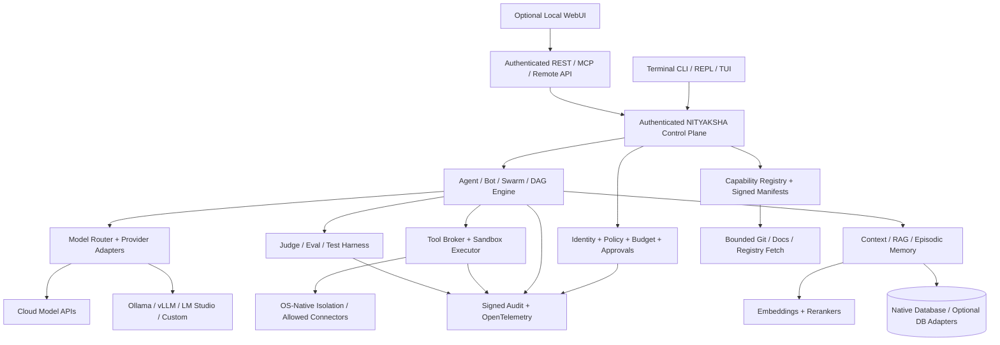
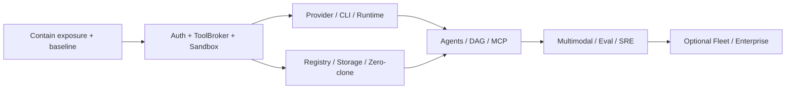

# NITYAKSHA (`ntx`) — Enterprise Full Scope of Work
## Source-grounded rebuild · Production-hardening roadmap · Architecture & acceptance specification

| Document field | Value |
|---|---|
| Project | NITYAKSHA / `ntx` — Universal AI Concierge, Agent Runtime and Capability Control Plane |
| Document version | 2.0 — Comprehensive Engineering SOW |
| Date | 4 November 2026 |
| Repository | [`simhaonline/ntx`](https://github.com/simhaonline/ntx), default branch `main` |
| Starting release | Source declares `ntx` 1.0.0; this SOW defines a successor release, **not** a completed implementation |
| Current primary implementation | **Rust**, Rust edition 2024; preserve the existing Rust core and CLI; no mandatory Python or Node.js runtime |
| Delivery posture | **Security remediation first; then test, extend, benchmark, and release** |
| Planned formats | Single executable CLI; opt-in local service/API/WebUI; optional fleet/enterprise management |
| Baseline evidence | User-supplied 70-line SOW; repository metadata/tree and selected source files inspected on 4 November 2026 |
| Verification boundary | **Source inspection only**. No build, runtime test, deployment audit, exploitation test, measured performance test or exhaustive audit was performed during SOW preparation. |

> **Important classification:** `BASELINE` identifies a capability described by the supplied SOW or visible in selected repository code. `VERIFY` means functionality or security properties are **not independently demonstrated**. `BUILD` is a new required deliverable. `FIX` is a source-observed deficiency requiring correction. No unchecked claim of “100% complete,” “ACID compliant,” “secure sandbox,” or “production ready” is accepted as a release criterion.

---

## 0. Executive decision and immediate operational priorities

NITYAKSHA shall be a **local-first, cross-platform, modular, sovereign-capable AI orchestration system** combining a terminal concierge, unified provider gateway, autonomous but policy-controlled agents, bots/swarms, DAG workflows, persistent memory and retrieval, a searchable library of **SKILLS / AGENTS / MCP SERVERS / PROMPTS / PLUGINS / WORKFLOWS / TOOLS**, reproducible execution and rigorous governance. Its distinctive operating model is **zero-clone, metadata-first ingestion**: external repository sources are indexed through manifests, files, documentation and Git provider APIs without cloning large source trees by default. Only specifically approved and verified execution artifacts are materialized.

**Do not expose the present service as an Internet-accessible command executor while the findings below remain unresolved.** The inspected repository implementation binds the HTTP server to `0.0.0.0`, advertises a public HTTP address, applies `Access-Control-Allow-Origin: *`, and includes a `POST /api/sandbox/run` route with no evident authentication check in the request handler. That route passes the submitted command to a `sh -c` execution path on Unix. The same source shows several control-plane mutations without an evident caller identity check. This combination must be treated as a **critical suspected unauthenticated remote-command-execution exposure** requiring defensive isolation until verified and corrected. This statement is based on static inspection, not a live attack or penetration test.

### 0.1 Release-blocking findings — must remediate before any public exposure

| ID | Priority | Source-observed concern | Required remediation / objective evidence |
|---|---|---|---|
| SEC-001 | P0 | Server uses an all-interface bind and unencrypted advertised HTTP endpoint. | Default localhost only; explicit opt-in network bind, TLS 1.3 or trusted TLS termination, private access path, firewall policy and deployment exposure tests. |
| SEC-002 | P0 | `/api/sandbox/run` and other sensitive API routes show no visible authn/authz gate. | Disable dangerous endpoints by default; require authenticated principal, capability grants, scoped workspace, RBAC/ABAC and action authorization for every route; reject anonymous requests with `401/403`. |
| SEC-003 | P0 | `SandboxManager::execute` launches a host shell; in inspected path no call to `IsolationEngine::apply_confinement` is visible. | Enforce actual isolation in child pre-exec / secure runner before command start; verify namespaces/UID/cgroups/seccomp/filesystem containment from process introspection; **fail closed**. |
| SEC-004 | P0 | Isolation setup logs warnings and continues when `unshare` fails; cgroup provisioning/attachment errors are ignored. | Block execution upon confinement failure, except explicitly approved read-only no-exec degradation; propagate errors; test deliberately unavailable namespaces/cgroups. |
| SEC-005 | P0 | `IbacGate` uses string substring checks for prohibited shell commands; an approval-required decision does not visibly block the sandbox executor before launch. | Policy decisions enforced at execution boundary; structured operation APIs, deny-by-default, canonical paths and arguments, approved command templates, non-bypassable HITL. Never rely on keyword filters alone. |
| SEC-006 | P0 | Provider configuration writes serialized settings to JSON without demonstrated OS-level encrypted secret-store integration; provider models contain an `api_key` serializable field. | Externalized vault / OS keyring, encrypted at rest, masked responses, ownership permissions, atomic writes, secret-scanning and rotation; never return or log credentials. |
| SEC-007 | P0 | HTTP handler parses a fixed 8 KiB raw buffer, derives body from an initial read, and manually handles protocol details. | Replace with a maintained, audited Rust HTTP stack or fully spec-compliant bounded parser; content-length, chunking, limits, timeouts, request smuggling protections, safe concurrency and structured errors. |
| SEC-008 | P1 | MCP stdio handshake requests protocol `2024-11-05`, while the protocol has newer published revisions; transport coverage is stdio-focused. | Version negotiation, conformance tests; support compatible stdio + versioned Streamable HTTP; explicit legacy compatibility policy and auth controls. |
| SEC-009 | P1 | Audit hash chain begins with a fixed seed on manager initialization; a local append-only file does not alone establish tamper-proof storage. | Durable chain heads across restarts, signatures/checkpoints, rotation integrity, remote append-only export and independent verification. |
| SEC-010 | P1 | README and source make inconsistent provider/platform/performance claims; examples include 21, 36+ and 37+ provider counts. | Generate capability matrices and counts from tests; publish supported vs configured vs reachable, per-OS verified behavior and reproducible benchmark evidence. |

### 0.2 Non-negotiable project principles

1. **Rust-first:** Keep the existing Rust crate, CLI interface and module boundaries. Any external runtime (Ollama, vLLM, Chroma, database or model training framework) is a **separate opt-in service**, never an undeclared core dependency.
2. **Offline-first, sovereign by choice:** A fully local route can operate without cloud credentials; every outbound call requires an active policy and clear routing/retention metadata.
3. **No default repository cloning:** Fetch only bounded, necessary remote content via APIs and raw blobs; cache by content hash. Full clones are exceptional, explicit and quota-limited.
4. **Capability data is not authority:** A retrieved skill, prompt, source document, GitHub README or MCP output is untrusted content. Installation, escalation, credentials, tool execution and policy changes require separate authorization.
5. **Fail-closed execution:** A claimed sandbox is not considered active unless all configured primitives are verifiably enforced; failures must not silently become host execution.
6. **Human agency over irreversible actions:** Model instructions cannot self-authorize spending, trading, destructive changes, external communications, credential access or production deployments.
7. **CLI is first-class:** WebUI and API remain supported, but terminal workflows must not depend on them. Headless mode must be complete.
8. **Auditable and testable:** Every critical claim requires a named acceptance test with captured evidence, benchmark methods and provenance.
9. **Extensible and model-neutral:** Stable protocols, semantic versions, exportable portable manifests, provider adapters and independent agent registries.
10. **Privacy, resource control and observability:** Isolation per user/tenant/workspace/session, budgets per run, minimal retained data and actionable cost/latency measurements.

---

## 1. Starting baseline and scope interpretation

### 1.1 Baseline modules preserved

The supplied SOW describes approximately 18,150 lines of code and 38 core modules. The repository tree contains the following **confirmed paths** in Rust source. Presence of a path is **not** proof that every advertised feature works.

| Domain | Existing paths / types | Classification | Required disposition |
|---|---|---|---|
| Provider gateway | `src/provider/mod.rs`, `google_oauth.rs`, `router.rs`, `src/router.rs` | BASELINE / VERIFY | Retain; normalize SDK behavior; test real providers, streaming and fallback. |
| CLI & interactive shell | `src/cli/mod.rs`, `interactive.rs`, `src/main.rs` | BASELINE / VERIFY | Retain flags, profiles and themes; rationalize and document command coverage. |
| API & WebUI | `src/server/mod.rs`, `webui.rs` | BASELINE / FIX | Security redesign required; existing visual layout must not dictate API boundaries. |
| Agent harness | `src/harness/{mod,adapter,ast_pruner,budget,eval_judge,governance,mcp_client,memory,prompt_loop}.rs` | BASELINE / VERIFY | Harden execution, evidence, context and approvals. |
| Memory and retrieval | `src/db/{mod,relational,vector,hybrid,multimodal,columnar,versioning}.rs` | BASELINE / VERIFY | Define transactions, migrations, schema, corruption testing and optional backends. |
| Workflow and bots | `src/workflow/mod.rs`, `src/bot/mod.rs` | BASELINE / VERIFY | Generalize scheduling, persistence, coordination, versioning and conflict handling. |
| Sandbox | `src/sandbox/{mod,cgroup,ibac,isolation}.rs` | BASELINE / FIX | Full containment enforcement and cross-OS isolation implementation. |
| Capability scraping | `src/scraper/mod.rs` | BASELINE / VERIFY | Replace naive extraction/security assumptions, add provenance and bounded fetch. |
| Other engines | `src/anti_slop.rs`, `arena.rs`, `redteam.rs`, `ring_buffer.rs`, `sre.rs`, `lib.rs` | BASELINE / VERIFY | Retain semantics but integrate into test-driven engine interfaces. |

### 1.2 The eight user-supplied “closed gaps” remain traceable

The uploaded SOW reports implemented capabilities for (1) multi-step tool calls, (2) SSE streaming, (3) neural embeddings, (4) LLM judge, (5) stdio MCP, (6) AST pruning, (7) interactive WebUI modules, and (8) LoRA export plus documentation scraping. This SOW **preserves all eight** but replaces implementation-only assertions with independently reproducible acceptance cases (Section 18). No functionality is intentionally removed.

### 1.3 Current claims that require qualification

- **“36+/37+ providers”** means **declared adapters or catalog entries**, not independently validated authenticated end-to-end support. Separate *listed*, *configured*, *verified*, *healthy* and *production-certified* counts.
- **“True token-by-token SSE”** requires verifying stream framing, streaming tool call deltas, partial UTF-8 boundaries, cancellation, timeouts, reconnection policy and per-provider support. Buffered chunk output is not a guarantee of true streaming.
- **“Full ACID / MVCC / millions of vectors”** requires crash recovery, isolation, concurrent write, fsync and scale benchmark evidence. A disk-backed implementation or hash-based snapshots do not by themselves prove these properties.
- **“AST”** is not equivalent to simple indentation/brace heuristics. Implement actual parser backends or accurately label lexical fallback and confidence.
- **“All capabilities are first-party/proprietary”** must not erase third-party original licenses, authorship or provenance. Capability wrappers may be original, but imported source/reference artifacts retain their legal identity.
- **“Zero-dependency binary”** should mean *no required Python/Node daemon for core operation*, **not** zero Rust crates or zero external programs. Selected code invokes `curl`, shells and optional providers.
- **macOS/iOS/ARM support** shown in README is an intended support surface, not demonstrated by the supplied two-binary x86_64 release. Platform status must be evidence-based.

---

## 2. Product definition, personas and system boundaries

### 2.1 Product outcome

One cohesive NITYAKSHA runtime shall let a single operator or enterprise team **discover, register, inspect, compose, approve, execute, evaluate, retain, share, version and revoke** AI capabilities and workflows. It shall support remote SaaS inference, local/self-hosted inference, offline knowledge retrieval and secure file/system work without surrendering control of data or host resources.

### 2.2 Target users

- **Individual developer/operator:** terminal assistance, research, coding, testing, documentation and desktop/workstation automation under explicit workspace grants.
- **AI engineering team:** reusable agents, evaluation suites, model routing, benchmark leaderboards, reusable prompts, skill packages and versioned workflows.
- **Organization administrator:** access policy, quotas, identity, fleet enrollment, audit review, configuration distribution and disaster recovery.
- **Security/compliance operator:** scoped testing, red-team simulation in owned environments, threat detection, policy verification and incident forensics.
- **Integrator/publisher:** package, document and distribute third-party or first-party tools with controlled manifests and attestations.
- **Service operator/SRE:** monitor run health, spending, endpoint availability, deployment integrity and controlled rollback.

### 2.3 Core use cases

Provider onboarding; chat and tool use; code inspection/refactoring; multi-model discussion and review; autonomous non-destructive research; DAG orchestration; multimodal document understanding; reproducible code execution; local RAG; source-to-skill synthesis; skill publishing; MCP client/server interoperability; governed swarm handoff; policy-bound system and API automation; scheduled jobs; dataset/LoRA preparation; evaluation and replay; device/host/tenant administration; structured enterprise integrations.

### 2.4 Explicit boundaries

- No unrestricted remote shell exposed through the public API.
- No silent exfiltration of private files, private keys, model prompts or embeddings to external providers.
- No automatic installation of externally found instructions or binaries merely because a model requested them.
- No legal or technical assertion that generated source derived from third-party works is inherently proprietary.
- No full generative model training inside the Rust executable; instead expose training pipelines via optional approved workers.
- No claim of hardware-enforced Linux namespace isolation on Windows/macOS/iOS; specify and test OS-native alternatives or disable privileged tasks.
- No unrestricted or unapproved live broker, financial, payment, production infrastructure or customer-data modifications.

---

## 3. Target architecture and bounded deployment modes

### 3.1 Logical architecture



### 3.2 Execution planes

| Plane | Responsibilities | Boundary |
|---|---|---|
| **Control** | Auth, policy, plans, job scheduling, approvals, versions, budgets and routing metadata | Never runs arbitrary user commands inside control process |
| **Execution** | Sandboxed agent/tools, code/tests, process limits, allowlisted external actions | Isolated OS identity and workspace; hard process exit; independent resource caps |
| **Data** | Operational DB, memory index, vector search, artifact CAS, logs and backups | Tenant- and principal-scoped; encrypted where sensitive |
| **Integration** | MCP, provider APIs, Git APIs, data connectors, event delivery | Scoped grants, egress policy, credential isolation |
| **Observability** | Telemetry, trace correlation, security events, cost and health | Redaction and access restrictions; no default raw secrets |

### 3.3 Supported modes

1. **Standalone CLI** (`ntx`): local profile, native file storage, no open TCP listener by default, offline-safe startup.
2. **Local workstation daemon** (`ntx serve --host 127.0.0.1`): explicit local API/WebUI, browser access guarded by local authentication and origin validation.
3. **Private remote node**: mutually authenticated or OIDC-authenticated access over TLS; agent workloads sandboxed, scoped to host/tenant.
4. **Enterprise/fleet**: optional central control plane with remotely enrolled runner nodes, tenant isolation, queue and HA storage. This is **later-phase optional**, not mandatory for the single binary.
5. **Air-gapped/private**: configured local models, private registries, offline artifact bundle and no external provider failover.

### 3.4 Runtime/component strategy

- Preserve **Rust 2024** for CLI, orchestration, server, provider adapters, registry and sandbox controllers.
- Prefer well-maintained native Rust libraries for HTTP, async I/O, TLS, parser, OAuth, crypto, persistence and telemetry, subject to license/SBOM checks.
- Optional external backends: **ChromaDB**, PostgreSQL + pgvector, Qdrant, OpenSearch/Meilisearch and S3-compatible stores; default native engine remains available until migration is justified by test results.
- Optional external inference/training runtime: Ollama, vLLM, llama.cpp, PEFT and model containers. The core must work without installing them.
- Cross-platform runners expose a **uniform policy contract** with OS-specific enforcement and documented unsupported capabilities.
- All IPC and API operations use versioned schemas and stable error codes.

---

## 4. Functional work packages — system of record

**Priority guide:** `P0` security/correctness release gate; `P1` production feature; `P2` controlled expansion. Each requirement below has a corresponding acceptance obligation, even where detailed tests are grouped later.

### WP-01 — Bootstrap, CLI and interaction engine `[P1]`

**Preserve:** typed CLI, interactive concierge, palettes, selected cockpit tabs, provider listing, sessions, streaming output and JSON mode.

**BUILD:**
- Consistent grammar, `--help`/`--version`, positional/flag validation, shell completion (Bash/Zsh/Fish/PowerShell), man pages, rich exit codes, structured stderr, terminal resize and non-TTY modes.
- Namespaced commands for `init`, `doctor`, `config`, `auth`, `provider`, `model`, `agent`, `bot`, `swarm`, `workflow`, `skill`, `mcp`, `plugin`, `prompt`, `tool`, `memory`, `knowledge`, `catalog`, `policy`, `approval`, `sandbox`, `job`, `session`, `audit`, `bench`, `eval`, `train`, `backup`, `restore`, `upgrade`, `serve` and `fleet`.
- Reusable profiles: personal, project, organization; lockfile-pinned capability versions; configuration precedence **CLI > environment > workspace > user > system defaults**, except mandatory security policies always take precedence.
- `--dry-run`, `--plan`, `--explain`, `--trace`, `--output json|ndjson|text`, `--no-network`, `--workspace`, `--budget`, `--max-steps` and `--timeout` consistently available where applicable.
- Separate informative UI text from machine-readable output; no color when redirected; Unicode-safe, accessible keyboard navigation, screen reader compatible concise mode.
- Resume/fork/import/export sessions with content hash, restore points and clean exit handling.

**Acceptance:** command snapshot/golden tests; consistent help and invalid-argument errors; non-interactive CI pipelines; Windows/Linux terminal tests; permission prompts never appear unexpectedly in headless mode.

### WP-02 — Identity, tenancy and access control `[P0]`

**BUILD:**
- User accounts, service accounts, organizations, projects, workspaces, sessions and capability-owned identities.
- Local authentication for workstation mode; pluggable enterprise **OIDC/OAuth 2.0**, SSO, MFA and short-lived service tokens when remotely deployed.
- RBAC roles (owner, admin, operator, developer, approver, auditor, viewer) plus ABAC/ReBAC policies across tenant, project, workspace, secret, tool, artifact, model and deployment environment.
- Minimum privileges, scoped API keys, revocation, token rotation, expiration, user provisioning/deprovisioning and privilege-elevation audit.
- Separation-of-duties for approval of self-authored destructive actions; maker-checker policy for capital movement and production changes.
- Immutable principal/tenant/workspace context passed through **every** internal event, tool call, job and API response.

**Acceptance:** anonymous access to privileged endpoints denied; cross-tenant negative tests; revoked tokens immediately rejected; audit includes authentic actor and effective grants.

### WP-03 — Provider registry and universal model gateway `[P1]`

**Preserve:** declared providers, Google OAuth flow, model selection, adaptive tiers, circuit breakers, custom OpenAI/Anthropic-style endpoints, Ollama/LM Studio/vLLM integration.

**BUILD:**
- Declarative provider manifest with API dialect, auth, regional endpoints, available models, modalities, tokenization, context limits, pricing, rate limits, latency, JSON/tool-call/streaming support and residency.
- **Discovery vs capability testing:** list provider, probe credential validity, probe models, test structured outputs, test tools, test vision/audio and record verified support date.
- Full request/response normalization for system/developer/user roles, tool call IDs, tool results, multimodal content blocks, errors, refusal/finish reasons, usage and streaming deltas.
- Explicit limits and models updated from real provider metadata; no guessed per-model window or fictitious model identifier in a production default catalog.
- TLS validation, proxy support, mTLS where required, configurable timeouts, retry-after handling, backoff with jitter, idempotency keys where supported, cancellation and circuit breaker per provider/model.
- Secrets via OS keychain/vault/env references. Per-tenant key ownership, no credentials in client JSON or logs.
- Provider integrations tested independently; service availability must never be inferred from static catalog entries.

**Acceptance:** contract suite for each **production-certified** provider; resilient 429/500/network failures; no cross-provider leakage; correct chunk ordering/tool assembly and token/cost attribution.

### WP-04 — Intelligent model routing and multi-model reasoning `[P1]`

**BUILD:**
- Policy-based routing using task class, provider capabilities, complexity, modality, required privacy, locality, availability, user policy, cost and SLA.
- Routing tiers: `FastFlash`, `Balanced`, `DeepReasoning`, `Code`, `Vision`, `Audio`, `Embedding`, `Rerank`, `Fallback` and custom; no forced dependence on proprietary model branding.
- Classifier versioning, traceable routing explanation, routing simulation and AB evaluation.
- Budgeted ensembles: parallel candidate generation, independent critic, weighted voting/consensus, disagreement detection and deterministic tie-break; no automatic amplification without budget consent.
- Model fallback **only among compatible policies**: never fail from private/local-only to public cloud, or from EU-only residency to another region without approval.
- Per-model max input/output tokens, rate/concurrency budget, cached-prefix support, adaptive truncation, prompt compression with accuracy evaluation and retrieval relevance guards.

**Acceptance:** unit tests for policy compatibility, deterministic routing under pinned data, failure mode replay and cost-cap proof.

### WP-05 — Autonomous agent runtime and orchestration `[P1]`

**Preserve:** provider ReAct loop, tools (`read_file`, `write_file`, `edit_file`, `grep_search`, `ast_prune`, `bash_sandbox`), step counter and workspace gates.

**BUILD:**
- Standard lifecycle: `CREATED → PLANNED → AUTHORIZED → RUNNING → WAITING_APPROVAL/WAITING_INPUT → COMPLETED/FAILED/CANCELED`, durable checkpoint, resume and replay.
- Explicit planner/executor/reviewer separation; model-generated intentions do not equal permissions.
- Configurable steps, wall clock, compute, tokens, retries, tool recursion, child agents, disk, network and financial budgets; a ceiling at each ancestor run/tenant.
- Idempotency for mutating tool calls, safe retries, rollback/compensating action, exactly-one human approval per declared execution fingerprint.
- Context and tool-result provenance, stale-content flags, side-effect classification, execution evidence and reproducible result artifacts.
- Queue with priority, fair scheduling, cancellation, timeouts, concurrency control, backpressure and resumable interrupts.
- Safe no-op / manual handoff on exceeded risk or inability to enforce policy.

**Acceptance:** forced crashes and restarts recover without duplicate side effects; a child cannot exceed parent budget; tool injection cannot bypass policy.

### WP-06 — Bots, personas and subagent registry `[P1]`

**Preserve:** 7 reported bots: concierge, code architect, quant-risk, security-redteam, DevOps/SRE, anti-slop strategist and legal/compliance; existing agent persona and bot definitions.

**BUILD:**
- Versioned bot manifests (role, objective, allowed tools, memory scope, model tiers, output schema, risk tier, capabilities, author, license, source, acceptance tests).
- Bot templates for research, coding, QA, security defensive assessment, SRE, documentation, data analysis, compliance, data extraction, creative work and quantitative risk.
- Hierarchical agents; delegation with bounded privilege (`delegated scopes ⊆ parent scopes`), max depth, max spawn count and TTL.
- Tool provenance and conflict detection when two bots attempt concurrent mutation of the same resource.
- Agent-level health, outcome quality, error rate, evaluation history and opt-in sharing in organization catalog.

**Acceptance:** spawning, canceling and resuming are deterministic; agent identity and effective permissions are visible; collision tests do not corrupt files.

### WP-07 — Swarm coordination and multi-agent collaboration `[P1]`

**BUILD:**
- Manager/worker, blackboard, pipeline, map-reduce, critic-judge, debate/consensus and event-driven swarm patterns.
- Shared blackboard with typed messages, causal order, message TTL, immutable IDs, receipts, deduplication and bounded queues.
- Lease-based task ownership and file/resource locks, conflict resolution, version checks and stop-the-world override.
- Task DAG fan-out/fan-in, minimum quorum for high-risk output, duplicate work avoidance and progress telemetry.
- Budget pooling with hard caps, fair scheduling, delayed worker recovery and orphan detection.

**Acceptance:** 100 concurrent simulated workers do not duplicate a locked side effect; queue replay and node crash tests pass.

### WP-08 — DAG workflows, missions and scheduling `[P1]`

**Preserve:** Kahn topological validation, workflow definitions, node types, suspension and HITL gate concept.

**BUILD:**
- Typed workflow schema with steps, dependencies, branches, maps, joins, loops (bounded), human tasks, timers, webhooks, subworkflows, resource locks and compensation.
- Input/output JSON schema, templating with escaping, secret references and lineage; schema validation before execution.
- Triggers: CLI, API, cron (with timezone), event bus, file/Git event, scheduler and manual approval. Avoid scheduling until scheduler is explicitly enabled.
- Distributed retry semantics, poison queue, exponential backoff, expiry and dead-letter handling; resume after reboot.
- Immutable workflow versions, dry-run simulation, version migrations, preview of every side effect and rollback plan.
- Visual DAG editor remains optional; CLI is the authoritative interface.

**Acceptance:** cycle rejection, branch determinism, retry/idempotency behavior, human approval timeout and version-pinned replay tests.

### WP-09 — Tool broker, safety semantics and OS execution `[P0]`

**BUILD:**
- A central `ToolBroker` shall be the **only** execution gateway for local commands, filesystem writes, network actions, subprocesses, browser operations and MCP tools.
- Typed tool schemas with permission classes: `READ`, `WRITE`, `PROCESS`, `NETWORK`, `IDENTITY`, `SECRET`, `EXTERNAL_EFFECT`, `IRREVERSIBLE`.
- Secure path resolution, symlink escape defense, canonical workspace grants, TOCTOU mitigation, per-tool allowlists, restricted environment, no implicit shell interpreter for structured file ops.
- Commands run in isolated worker process with exact argv; shell use only as an explicit audited high-risk tool.
- Bounded stdout/stderr, redaction, process tree kill, CPU/RAM/disk/pid/network quotas, network allowlist and isolation attestations.
- Two-stage policy: preflight plan and execution-time enforcement; no permission skipping from untrusted input or model-generated flags.
- Capability-specific approvals with owner, expiry, nonce, action hash and single-use replay protection.

**Acceptance:** blocked operations yield no side effects; sandbox proof includes PID, effective UID, namespaces, cgroup and mount policy; process cannot access parent secrets.

### WP-10 — Cross-platform sandbox implementation `[P0]`

**Linux:** real user/mount/PID/IPC/UTS/network isolation as needed, secure rootfs (pivot_root/overlay/bind allowlists), `no_new_privs`, seccomp, capability drops, read-only mounts, device controls, cgroups v2, kernel feature probes and rootless operation; no silent degradation.

**Windows:** restricted tokens, Windows Job Objects, AppContainer/isolated VM where feasible, integrity levels, ACL boundaries, process tree and network confinement. If a requested guarantee cannot be provided, **disable the operation** with a machine-readable reason rather than report sandbox success.

**macOS:** explicit sandbox profile or virtualization mechanism with verified file/network restrictions; documented version compatibility and testable capability matrix.

**iOS/iPadOS:** terminal-hosted or remote-agent client mode only within platform constraints unless a verified supported isolation API exists; avoid implying Linux namespace equivalence.

**Acceptance:** penetration-oriented regression suite for container escape, symlink race, host Docker socket access, namespace failure, mount exposure, PID/process escalation and cross-workspace reads; independent security review before public release.

### WP-11 — Universal capability registry: SKILLS / AGENTS / MCP / PROMPTS / PLUGINS / TOOLS `[P1]`

**BUILD:**
- Unified catalog abstraction with `kind`, namespace, stable ID, semantic version, publisher, canonical source, digest, content signature, SBOM/license, runtime requirements, capabilities, minimum compatibility, tool scopes, target platforms, test suite, popularity and quality indicators.
- Capability lifecycle: `DISCOVERED → INDEXED → QUARANTINED → REVIEWED → APPROVED → INSTALLED/ACTIVATED → DEPRECATED/REVOKED`.
- Operations per kind: add, discover, import, inspect, preview, lint, validate, test, diff, version, pin, resolve, activate, disable, rollback, migrate, export, publish, revoke and uninstall.
- Workspace-level overlays, organization registry, inherited policies and pinned lockfiles. Conflicts must be diagnosed rather than silently overwritten.
- Runtime compatibility adapters for **Codex, Claude Code, Gemini CLI, Hermes and generic MCP-capable agents**, without assuming all ecosystems use identical schema or installation semantics. Any supported import/export format must have a dedicated round-trip test.
- Structured catalog index with lexical, semantic and facet search; tagging by language, modality, tool risk, industry, license, input/output type, platform, provenance and evaluation rating.
- Capability manifests are **data**, never executable instructions until approved; no unreviewed script execution from GitHub, scraped sites or agent responses.
- Comprehensive dependency graph of skills, tools, models, prompts, MCP servers and runtime capabilities, including compatibility and revocation impact analysis.

**Acceptance:** capability CRUD for every kind; signed/pinned manifest verification; reproducible install; correct dependency resolution; offline catalog browsing; quarantined content cannot execute.

### WP-12 — Metadata-first, zero-clone content acquisition `[P1]`

**Preserve:** document scraping, Git source provenance in capability rows, corpus-to-skill synthesis and low-disk-footprint intent.

**BUILD:**
- **GitHub/GitLab/Gitea/Forgejo-compatible adapters**, where enabled: repository metadata, branch/commit, tree, README, releases, tags, Git blobs, file content, workflow manifests and license metadata via authenticated APIs. API adapters must handle ETags, pagination, rate limits, deletion and permissions.
- Remote `raw`/archive retrieval only for explicitly selected files or small dependency-closure packages; no `git clone` as default.
- Content acquisition policy: max bytes per file, max files per scan, depth, MIME, total daily bandwidth, maximum decompressed expansion, allowed hosts, redirects, download concurrency and retained cache size.
- Content-addressable deduplication (`SHA-256`), chunk hashes, source URL + commit pin, verified signature, retrieval timestamp, provenance and license record.
- Incremental sync using ETag/If-Modified-Since, webhook or commit comparison; durable cursors, conflict detection and tombstone propagation.
- Runbooks/skills generated **only after review** of source rights, malicious instructions, invocation safety and reproducibility. Distinguish *original synthesized instructions* from copied repository material.
- Source viewer, semantic extraction, exact line/path citations, optional AST indexing, dependency summaries, change monitoring and registry update reports.
- Storage reclamation policies: LRU/TTL, pinned/leased objects, user-requested retention and secure deletion for sensitive caches.
- SSRF prevention: block metadata endpoints, loopback, link-local/private IP and DNS rebinding for untrusted URLs unless explicitly allowlisted in a safe local connector profile. No unrestricted redirects.

**Acceptance:** indexing 1,000+ eligible repositories without cloning repository worktrees; deduped incremental sync; bounded bandwidth and disk usage; poisoned remote instruction is not executed.

### WP-13 — Memory fabric, knowledge graphs and retrieval `[P1]`

**Preserve:** operational relational tables, WAL-like persistence, vector collection, lexical index, hybrid search, multimodal CAS, versioning and short-term context.

**BUILD:**
- Separately defined **working, episodic, semantic, procedural, task, user-approved preference and organizational knowledge** memory with TTL and access rights.
- Namespace per organization / project / user / agent / workspace / session. A policy engine filters memory **before retrieval**, not only after results are returned.
- Configurable storage backends: native Rust storage (default), **ChromaDB-compatible adapter** (optional service), PostgreSQL + pgvector, Qdrant or another verified vector store. No Chroma instance required merely to start `ntx`.
- Pluggable embeddings with versioned `model_id`, dimension, normalization, metric, multilingual properties, chunking and evaluation; mixed embedding models must not share a vector collection silently.
- Hybrid retrieval: BM25/lexical, dense vector, metadata filters, reciprocal rank fusion, optional cross-encoder reranking, query rewrite, freshness, context diversity and citations.
- Document ingestion: Markdown, code, HTML, text, PDF, JSON, CSV, office formats, screenshots/images and audio/video transcripts **via supported parser or approved external worker**; preserve source offsets, page/section provenance, tables, diagrams and link relationships.
- Entity/relationship graph for people (where permitted), software, projects, files, dependencies, model/tool provenance, business concepts and historical decision traces.
- Memory writes are bounded, intentional, auditable, deduplicated, reviewable and deletable; untrusted content may not overwrite high-trust policies or system memory.
- Durable transactional state, schema migrations, backup, restore, PITR where supported, recoverability tests, snapshot verification and retention quotas.
- “Memory Palace” spatial/semantic loci may remain a visualization and retrieval organizational aid; it is not a security boundary.

**Acceptance:** recall quality on pinned benchmark sets, 100% access-filter correctness on negative fixtures, corruption/restart recovery, deletion propagation, version migration and exact source citation.

### WP-14 — Multimodal input, output and artifacts `[P1]`

**BUILD:**
- Typed messages for text, images, audio, documents, video frames, tool outputs, code, charts, structured data and mixed turn sequences.
- File type sniffing, size and malware scanning (through optional trusted scanner), sandboxed parsing, decompression limits, sensitive-data classification and quarantine.
- OCR, text extraction, layout/table extraction, image captioning/VQA, speech-to-text, translation, diarization (where permitted), audio summarization, text-to-speech and video timeline indexing via model/provider adapters.
- Content addressing of original bytes, derivatives, transcription, OCR bounding boxes, media metadata, access control and immutable provenance.
- Artifact creation as explicit workflows: Markdown, JSON, CSV, SVG and optionally DOCX/XLSX/PPTX/PDF using approved tools/services; rendering correctness tests and original-file preservation.
- No false assertion of model modality support: negotiate actual capabilities before request dispatch.

**Acceptance:** user-requested file parsing succeeds for certified formats; malformed media cannot escape parser sandbox; protected artifacts cannot cross workspaces.

### WP-15 — MCP client/server and tool ecosystem `[P1]`

**Preserve:** stdio JSON-RPC client and built-in server with initial `initialize`, `tools/list`, `tools/call`, sandbox/memory/AST operations.

**BUILD:**
- Compatibility against pinned **published MCP specification revisions** with discovery/negotiation rather than one hard-coded version. Include client/server conformance suite.
- Native `stdio` plus secure **Streamable HTTP** transport for supported revision(s). Older HTTP+SSE compatibility only as a separately tested legacy bridge; do not conflate model-output SSE with MCP transport rules.
- Tool, resource, resource template, prompt, completion and logging support as compatible with negotiated protocol. Pagination, list-change notifications and progress/cancellation where supported.
- Safe server process supervision: exact executable/args, signed manifest, allowlisted environment, launch timeout, process kill, stderr capture with redaction, stdout JSON-RPC-only framing and output limits.
- Remote MCP auth and authorization, Origin validation, remote URL allowlist, TLS, token audience binding, token forwarding prevention and per-tool permissions.
- Transport-level version compatibility matrix to account for spec evolution: the **2025-11-25** published revision supports stdio/Streamable HTTP; **2026 draft revisions** alter state/session/GET behavior and must **not** be shipped as finalized production behavior without explicit compatibility tests.
- MCP tools exposed through `ToolBroker`; server-side restrictions remain authoritative even if another client omits them.
- Catalog import from external MCP directories with source verification and revocation rules.

**Acceptance:** MCP conformance tests, malformed JSON-RPC handling, protocol version compatibility, DNS rebinding tests, arbitrary server stdout injection tests, denied tool execution and client disconnect cleanup.

### WP-16 — Plugin SDK, extension runtime and ecosystem `[P1]`

**BUILD:**
- Capability package format including commands, hooks, declared permissions, event subscriptions, configuration schema, dependencies, lifecycle and API compatibility.
- **WASM/WASI or out-of-process plugin runtime** as preferred containment; native dynamic plugins are privileged and separately signed/approved.
- ABI/API stable contracts for plugin registration, telemetry, policy checks, cancellation and secret handles. Versioned SDK and compatibility guide.
- Hooks such as `before_prompt`, `after_response`, `before_tool`, `after_tool`, `before_memory_write`, `before_publish`, `on_error`, `on_shutdown`, with strict timeout and fault isolation.
- Marketplace/index with human-reviewed provenance, publisher verification, package signatures, signed releases, dependency integrity, version pinning and rollback.
- Automatic compatibility checks with Codex/Claude/Gemini/Hermes manifests where feasible; adapters may convert formats but cannot claim runtime parity without tests.

**Acceptance:** isolated sample plugins, crash non-propagation, no capability escalation, deterministic upgrade/rollback and memory/resource quota enforcement.

### WP-17 — Prompt engineering and policy-safe template management `[P1]`

**BUILD:**
- Namespaced prompt registry with version, locale, expected role, variables, JSON schema, model capability requirements, test fixtures and provenance.
- Typed and escaped templating with validated substitutions and sensitive field masking; prompt linting and injectability analysis.
- A/B prompt evaluation, regression tests, token-budget analysis, multilingual localization and deterministic snapshots.
- Clear instruction hierarchy between system/developer policy, explicit user task and untrusted retrieved text; retrieval never grants command authority.
- Safe prompt distillation and few-shot reuse with license/data-privacy controls and provenance; no opaque reuse of secrets from prior sessions.
- Existing anti-slop response stylistic filtering becomes **optional and non-lossy**; must not strip factual caveats, evidence, errors or safety notices.

**Acceptance:** reproducible render, controlled overrides, injection test corpus and prompt-regression evaluation.

### WP-18 — Code intelligence, AST, LSP and developer tools `[P1]`

**Preserve:** repository traversal, call-graph approximation, context pruning and code tool invocation.

**BUILD:**
- True language parsers via approved Rust libraries (e.g., Tree-sitter grammar integration) for Rust, Go, Python, JS/TS, C/C++, Java and supported others; confidence-marked lexical fallback when grammar unavailable.
- Symbol graph, imports, definitions/references, call graphs, type/language server queries, dependency discovery, cross-file indexing, incremental reparse and source spans.
- Git-aware diff/patch, worktree safety, branch isolation, lock and merge conflict controls, automatic reversible patch backup.
- Language-independent test/build runner with explicit toolchains; repo-provided commands never auto-run without permission.
- Context assembly optimized for relevant symbols with exact file path, line offsets, branch and commit provenance; prevent source-truncation confusion.
- Structured code reviewer, vulnerability scanner integrations, refactor planner, coding/test agent and change impact assessment.

**Acceptance:** parser fixtures against real projects, edge-case symbol resolution, accurate range citation and no change outside granted worktree.

### WP-19 — Evaluation, judges, benchmark arena and testing agents `[P1]`

**Preserve:** deterministic checks, G-Eval-style LLM judge, unit-test synthesis, arena rankings, negative cache and red-team shield.

**BUILD:**
- Evaluation types: correctness, execution validity, schema adherence, evidence grounding, retrieval quality, tool efficiency, safety, latency, token cost, resilience and user-defined business KPIs.
- Pinned datasets and evaluation fixtures; golden outputs; reproducible seeds/settings where supported; versioned evaluator models and rubric definitions.
- Independent judges, calibrated scoring, pairwise comparison, human review and confidence intervals; judge agreement checks and benchmark contamination controls.
- Tests generated by LLM **never** replace independently specified requirements; tests run in isolated environments and inspect side effects.
- Model Arena with Elo/Bradley–Terry scores accompanied by sample sizes, dataset version, confidence estimates, win rates and selection bias warnings.
- Red-team suites for prompt injection, tool output manipulation, privilege escalation, memory poisoning, harmful automation, denial of wallet/service, cascading failure and rogue agent behavior in approved test systems.
- Regression gate in CI; block release on high-severity evaluation regression, unreviewed missing coverage or new security critical findings.

**Acceptance:** benchmark manifest can be replayed and independently checked; judge outcome includes rubric, evidence and rationale; evaluation results are immutable/versioned.

### WP-20 — Human approvals, policy governance and audit `[P0]`

**BUILD:**
- Central policy engine with rules on principal, tool, resource, namespace, data class, environment, budget, provider, user intent and execution side effects.
- Default policies: read-only without trust, deny secret disclosure, deny host admin access, deny irreversible operations, no cross-tenant data access, network off for untrusted code.
- Explicit policy bundles, allow/deny precedence, per-team exceptions, review signatures, expiry and emergency lockdown/revoke.
- HITL requests bound to **exact action hash + args + target + workspace + identity + revision + deadline**, single use, no self-approval when separation of duties applies; reapprove after any material change.
- Approval channels: secure CLI and authenticated WebUI/API; asynchronous queue is durable, supports rejection/expiration, and fails closed on timeout.
- Audit trail: who/what/where/when/why/policy/model/provider/tool/approval/result/artifact IDs; redact content subject to retention rules.
- Hash chain persistently checkpointed and periodically signed; evidence export to append-only external target; integrity verification tools.
- Conformance mapping to OWASP GenAI/Agentic risks, relevant NIST controls, data protection and customer-specific regulatory requirements without claiming certification automatically.

**Acceptance:** direct and indirect privileged paths are denied without valid approval; tampering detectable across log rotation/restart; policy tests cover every active API/tool.

### WP-21 — Secrets, encryption, privacy and data governance `[P0]`

**BUILD:**
- Keychain/libsecret/Windows Credential Manager or external secret manager integration; KMS/Vault integration for enterprise; OS file permission mode hardening on local fallback.
- Short-lived secret handles scoped to approved tool/provider, never returned to agent text; keys masked in JSON/CLI, logs, crash dumps and exported trajectories.
- At-rest encryption for confidential memory and credentials; TLS/mTLS for transit; rotation, revocation and encrypted backups.
- DLP checks before sending content to cloud provider or connected third party; configurable opt-out for remote training/data retention where supported.
- Data retention policy, right-to-delete propagation, export, workspace and tenant boundary, PII redaction and audit of access.
- Data classification: public, internal, confidential, restricted; provider route and storage selection inherit classification.
- Privacy-preserving telemetry by default; no hidden remote analytics.

**Acceptance:** secret-scanner test harness sees no keys in network response/log/snapshot; deletion and key rotation verification; cross-provider DLP policy enforcement.

### WP-22 — Secure service API, WebUI and remote control `[P0/P1]`

**Preserve:** existing seven-tab WebUI and API concepts while rebuilding trust boundaries.

**BUILD:**
- Replace the manually parsed HTTP server with robust Rust HTTP framework/stack; strict content validation, bounded bodies, per-route request and response schema, graceful shutdown and concurrency pools.
- Local server on `127.0.0.1` by default. Bind to non-loopback only after successful TLS/auth/firewall preflight and explicit `--expose` configuration.
- Full authentication/authorization middleware, per-route permissions, security headers, CSRF defenses for cookie sessions, strict Origin/Host/CORS allowlist, secure cookies, browser session expiration, rate limiting, API keys and OIDC support.
- Route partition: status/read-only routes; operator routes; privileged configuration/exec/approval routes. No public administrative API.
- OpenAPI 3.1 schemas and SDK generation for stable APIs, idempotency keys, conditional updates and typed error envelopes.
- WebUI: accessible responsive layout, light/dark themes, provider/model health, bot/workflow status, budget/cost telemetry, policy approvals, catalog, memory provenance, audit and diagnostics.
- Live event stream via authenticated WebSocket/SSE scoped to session, bounded fan-out and cancellation; avoid exposing model internals or other users' content.
- Backend command execution must remain behind the sandboxed runner even if invoked from a UI control.

**Acceptance:** full endpoint security matrix and automated ZAP-like defensive testing in isolated staging; no anonymous state mutation; API schema/property tests; UI role-based visibility.

### WP-23 — Scheduling, background jobs and notification delivery `[P1]`

**BUILD:**
- Local job queue and optional distributed broker; jobs include owner, recurrence, timezone, next run, priority, permissions, model caps, attempt counters, last result and expiry.
- Cron and event subscriptions support DST, duplicate prevention, missed-run policy, manual replay and pause/resume.
- Approved outbound channels: email, webhook, chat relay, filesystem event and enterprise notification integrations via connector grants; no unsanctioned message sending.
- Conditional monitoring jobs with safe polling intervals, webhook signature verification and delivery receipts.
- Reliable retries with deduplication and failure dead-letter queues; notification payload redaction.

**Acceptance:** restart continuity, no duplicate notification on replay, timezone transition tests and per-user opt-in preferences.

### WP-24 — Training, fine-tuning and dataset lifecycle `[P2]`

**Preserve:** conversation/trajectory export and training recipe generation.

**BUILD:**
- Curated dataset pipeline: collect only authorized trajectories, redact secrets/PII, deduplicate, score quality, label, split train/validation/test, hash and version.
- Export formats JSONL, ShareGPT, provider-specific supported types; ensure user consent and licensing before exporting to any cloud service.
- Optional workers for SFT, LoRA/QLoRA, DPO/preference training and evaluation, with explicit GPU environments and dry-run planning; do not force Python in the core binary.
- Fine-tuned adapter registry, provenance, model fingerprint, eval gate, rollout/canary, revert and reproducibility manifest.
- Training economics: time, VRAM, tokens, dataset footprint and projected cost; no unbounded upload or long jobs without approval.

**Acceptance:** reproducible export, redaction pass, training worker contract tests and benchmark gain without safety/performance regression.

### WP-25 — Cost, quotas, capacity and performance `[P1]`

**BUILD:**
- Per-request accounting: provider, model, input/cache/output tokens, estimates vs provider-reported billable usage, currency/price date and error interval.
- Budget scopes: request, run, child agent, workflow, session, user, project, organization and monthly account; preflight prediction plus post-billing reconciliation.
- Hard budget stops, soft warning alerts, anomaly detection, retry storm prevention and resource utilization telemetry.
- Router scorecards using quality, latency, pricing, availability, locality, supported context and energy/power data if available.
- Optional rate cards and chargeback/showback; pricing must be refreshable rather than hard-coded in binary.
- Resource ceilings for model context, disk cache, queue depth, file count, bandwidth, CPU, memory and sandbox lifetime.

**Acceptance:** no budget bypass through nested agents/retries; estimates reconcile within policy threshold; billable usage not falsely reported as exact when estimated.

### WP-26 — Observability, supportability and SRE `[P1]`

**BUILD:**
- Structured logs with severity, request/trace/run/span IDs, tenant/agent IDs (appropriately pseudonymized), redaction and rotation.
- OpenTelemetry-compatible traces and metrics across UI, gateway, router, job, provider, tool, sandbox, memory and judge; exporter optional.
- Metrics: successful/completed/failed/canceled runs, tool attempt count, queue time, first-token latency, p95 provider latency, checkpoint size, cache hit, route changes, approval delays, isolation status and cost.
- Health/readiness/liveness with dependency-specific details; health never returns `healthy` solely because HTTP responds.
- Operator runbooks: provider outage, vector index corruption, key compromise, tool runner containment failure, database disk full, backup restore and runaway agent.
- Backpressure, concurrency limits, heap/CPU profiling, graceful shutdown and controlled diagnostic bundle without secrets.
- Incident controls: revoke credential, terminate agent, disable plugin, pause queue, quarantine artifact, seal audit and roll back release.

**Acceptance:** redacted incident trace reconstructs exact action sequence; chaos tests alert on genuine failures and do not spam false positives.

### WP-27 — Installation, upgrades and software supply chain `[P0/P1]`

**BUILD:**
- Signed release artifacts, SHA-256 checksums, reproducible build manifests, SBOM, dependency licenses, CVE scanning and release attestations.
- Distribution: official source builds, verified binary assets, Linux packages/install script, Windows signing/MSI or PowerShell installer, optional Homebrew and container images after platform validation.
- No unaudited `curl | sh` or remote PowerShell execution as preferred installation path; provide downloaded checksum verification and transparent script inspection instructions.
- Upgrade channels (`stable`, `beta`, `nightly`), pinning, rollback, schema compatibility, backup before migration and safe removal.
- Cross-compile/build matrix, CPU/OS feature detection, binary architecture verification, provenance publishing and supply-chain incident response.
- Container builds run as non-root; image scanning, minimal FS, no Docker socket sharing, measured startup and footprint.

**Acceptance:** installer test on clean VMs; signature/checksum verified before execution; downgrade/rollback demonstrated; no data loss.

### WP-28 — Enterprise connectors and extensibility `[P2]`

**BUILD:**
- Common connector SDK for GitHub/GitLab/Forgejo, Google Drive/Docs/Sheets, Microsoft 365, databases, object storage, issue trackers, SCM, CI/CD, metrics and private enterprise APIs.
- Per-connector capability grants, tenant boundaries, OAuth token custody, webhook verification, data residency, retention and reconciliation.
- Standard read/search/write/transaction semantics; dry-run on mutation; structured output and provenance.
- Connectors installed as optional packages; NITYAKSHA starts successfully without them.
- Integration catalog distinguishes supported APIs, active user connection and permitted operations; no implicit access to user accounts.

**Acceptance:** mocked connector conformance, auth expiry/revocation tests, correct tenant scoping and idempotent mutations.

### WP-29 — Enterprise governance, teams and optional fleet `[P2]`

**BUILD:**
- Organization/workspace federation, role delegation, policy distribution, approvals and workspace templates.
- Runner enrollment with mutually authenticated identity, hardware/software attestation where practical, agent heartbeats and revocation.
- Central task routing to local/remote nodes based on data-classification, policy, hardware, model capacity and geography.
- Config rollout with staged approval, canary, rollback and immutable revision history.
- Offline runner lease expiry, orphan job recovery, site isolation and disaster recovery.

**Acceptance:** hostile runner cannot impersonate another; revoked node loses jobs and secrets; site outage does not compromise tenant boundary.

### WP-30 — Developer experience and formal compatibility `[P1]`

**BUILD:**
- Stable Rust library interface, embedded API, documented trait contracts and examples for providers, tools, registry plugins, memory, transport and evaluation.
- OpenAPI and JSON Schema package; optional code-generated Go/Python/TypeScript client SDKs **without changing the core language**.
- Compatibility contract and semantic versioning; deprecated flags/protocols retain clear expiry and migration tools.
- Local development setup, test fixtures, fake provider/MCP server, integration sandbox, reproducible demo data and developer docs.
- Code ownership, mandatory reviews for security-sensitive paths, changelog and architecture decision records (ADRs).

**Acceptance:** sample provider/tool can be built and tested from documented SDK; versioned compatibility matrix validated in CI.

---

## 5. Unified capability package and index schema

### 5.1 Minimum manifest (proposed schema, not a claim of current CLI support)

```yaml
apiVersion: nityaksha.io/v1alpha1
kind: Skill  # Skill | Agent | MCPServer | Plugin | Prompt | Tool | Workflow
metadata:
  namespace: research
  name: repo-code-analyst
  version: 1.2.0
  publisher: simhaonline
  source:
    type: github
    repository: simhaonline/ntx
    revision: "<immutable-commit-sha>"
    paths: ["src/harness/ast_pruner.rs"]
  digest: "sha256:<verified-package-hash>"
  license: "<spdx-identifier-or-REVIEW_REQUIRED>"
  status: reviewed
spec:
  description: "Bounded workspace code-analysis skill"
  modes: [offline, interactive, headless]
  runtime:
    engine: ntx
    minimumVersion: ">=2.0.0"
    os: [linux, windows]
  inputs:
    schema: { type: object, required: [workspace], properties: { workspace: { type: string } } }
  outputs:
    schema: { type: object }
  requestedPermissions:
    filesystem: { read: ["workspace:**"], write: [] }
    process: false
    network: { enabled: false }
    secrets: []
  resources:
    maxRuntimeSeconds: 180
    maxMemoryMiB: 256
    maxOutputKiB: 1024
  dependencies: []
  acceptance:
    testSuite: tests/skills/repo-code-analyst.yaml
```

This manifest is **documentation only** until the new schema validator, package signer and runtime adapters are implemented. `reviewed` is a workflow state, not proof of security or license ownership; release policy decides deployability.

### 5.2 Normalized metadata entities

| Entity | Required identifiers/relationships | Main invariant |
|---|---|---|
| Capability | `capability_id`, `kind`, `namespace`, `name`, `version`, `digest`, `publisher`, `source_id` | Immutable published version; signed provenance |
| Source | `source_id`, `host`, `repository/url`, `revision`, `license`, `retrieved_at` | Bounded fetch, immutable revision when possible |
| Dependency | `from_id`, `to_id`, `version_constraint`, `optional` | Closure validated and cycles rejected |
| Package install | `installation_id`, `capability_digest`, `tenant`, `workspace`, `approval_id`, `state` | Materialization only after approval |
| Tool grant | `principal`, `tool`, `resource`, `action`, `constraints`, `expiry` | Least privilege; deny by default |
| Evaluation | `eval_id`, `capability_digest`, `dataset_digest`, `policy_version`, `score`, `evidence` | Independent replay |
| Revocation | `digest`, `reason`, `signed_by`, `effective_at` | Stops new launches and triggers active risk review |

### 5.3 Retrieval and package lifecycle

1. **Discover** remote metadata, tags and permitted paths.
2. **Fetch** only selected bounded files / API blobs, calculating hashes and retaining source URLs/commit paths.
3. **Parse** Markdown/YAML/JSON and approved code references with size/format guards.
4. **Classify** capability kind, dependencies, license, privileges, compatibility and potential malicious instructions.
5. **Index** manifest/search text/embeddings/graphs with source provenance.
6. **Quarantine and review** executable content, hidden hooks and third-party licensing.
7. **Sign and approve** exact package digest under organizational trust policy.
8. **Activate** pinned version and inject only granted tool handles into the agent runtime.
9. **Observe and evaluate** execution quality/security; log evidence.
10. **Update, revoke or rollback** through audited version transitions with dependency impact notification.

### 5.4 Storage tiers and low-disk guarantees

- **Tier A — metadata:** repo ID, tree path, content digest, README summary, license and dependency graph; minimal storage.
- **Tier B — indexed selected file content:** bounded text/code, compressed and deduplicated.
- **Tier C — executable package:** downloaded only for approved execution, pinned to digest, TTL/lease-managed.
- **Tier D — optional full clone/build environment:** explicitly requested only, hard quota and isolated temp storage; cleaned after completion.

Required controls: per-user max cache, global dedupe, soft/hard quotas, LRU respecting pins, cache inspection, repair, prune dry-run and offline bundle export. Disk consumption must be measured on test datasets rather than described as “zero.”

---

## 6. Data architecture, durable state and disaster recovery

### 6.1 Minimum logical collections/tables

- `tenants`, `users`, `identities`, `roles`, `role_bindings`, `workspaces`, `api_credentials_refs`, `sessions`.
- `provider_catalog`, `model_catalog`, `model_health`, `model_pricing`, `routing_policy`, `usage_ledger`, `budget_ledger`.
- `capabilities`, `capability_versions`, `sources`, `source_revisions`, `capability_dependencies`, `registrations`, `revocations`.
- `agents`, `bots`, `agent_runs`, `agent_steps`, `tool_calls`, `tool_grants`, `sandbox_attestations`, `swarm_messages`, `resource_leases`.
- `workflow_definitions`, `workflow_versions`, `workflow_executions`, `workflow_events`, `workflow_step_runs`, `approval_requests`.
- `documents`, `chunks`, `embeddings`, `index_versions`, `retrieval_citations`, `memory_items`, `memory_summaries`, `knowledge_edges`, `media_assets`.
- `prompt_templates`, `prompt_versions`, `evaluations`, `evaluation_datasets`, `judge_results`, `benchmarks`, `artifact_manifests`.
- `jobs`, `schedules`, `job_deliveries`, `connectors`, `connector_grants`, `audit_events`, `audit_chain_heads`, `backup_manifest`.

### 6.2 Transactional rules

- Every record has tenant namespace, immutable ID, creation/updated revision, provenance and policy classification where applicable.
- State transitions use version/CAS guards to prevent lost updates; tool mutations include idempotency key and side-effect journal.
- A job moves to `COMPLETED` only when output persistence and required side effects have been acknowledged.
- Write-ahead log semantics: enforce ordering, checksums, fsync/durable flush policy, torn-write recovery and compaction under crash simulation before advertising ACID.
- MVCC snapshots only if repeatable-read/concurrent visibility rules are formally implemented and tested; otherwise name the actual guarantees accurately.
- Embedding/index rebuilds are asynchronous where necessary, with read-after-write behavior explicitly documented and an index generation watermark.
- SQLite or PostgreSQL may be used where custom store proof is insufficient; native database remains an optimization target, not a reason to lose integrity.
- Multimodal CAS references must be GC-safe under concurrent readers, uploads, deletion requests and backup retention.

### 6.3 Backup, migration and restore

- Point-in-time and consistent checkpoints for operational state, audit heads, manifests, vector index, media references and encrypted secret metadata.
- Database schema versioning with forward-only migration scripts plus compatible rollback plan.
- Offline encrypted backup, scheduled backup verification, automatic restore tests and disaster recovery runbooks.
- Proposed starting RPO/RTO targets (enterprise deployment, subject to infrastructure sizing): **RPO ≤15 minutes and RTO ≤4 hours**; standalone local users can choose snapshot cadence.
- Retention and legal hold policies; backup deletion honors data-classification and privacy obligations.

---

## 7. Interfaces, contracts and API design

### 7.1 Security-first API design principles

- Prefer `/v1/...` namespace; typed OpenAPI, schema validation, RFC-compatible HTTP response codes, per-operation permissions and request IDs.
- **All** mutating endpoints require authentication + resource authorization, replay protection where relevant, idempotency key and audit event.
- Restricted routes have specific scopes (`sandbox:execute`, `policy:write`, `provider:configure`, `workflow:approve`, `secret:use`, etc.).
- Reject untrusted `workspace_root`, filesystem paths, hostnames or commands unless separately authorized by the runtime principal.
- Do not serialize provider API keys or raw approval secrets into responses.
- Errors include `code`, `message`, `request_id`, `retryable`, `details` (redacted) and `policy_decision_id` where appropriate.

### 7.2 Proposed minimum API surface (target contract, not currently verified)

| Domain | Endpoints / pattern | Permission |
|---|---|---|
| Health | `GET /v1/health/live`, `GET /v1/health/ready`, `GET /v1/version` | Minimal public info or local only |
| Identity | `/v1/auth/*`, `/v1/me`, `/v1/tenants/*`, `/v1/workspaces/*` | Appropriate identity/tenant roles |
| Provider/model | `GET /v1/providers`, `GET /v1/models`, `POST /v1/providers/{id}/probe`, `/v1/routing/*` | Read/probe/admin scopes |
| Agent | `/v1/agents`, `POST /v1/agent-runs`, `/v1/agent-runs/{id}/events`, cancel/resume | `agent:run`, `agent:read` |
| Bot/swarm | `/v1/bots`, `/v1/swarms`, `/v1/swarms/{id}/messages` | Project-scoped bot/swarms grants |
| Workflow | `/v1/workflows`, `/v1/workflow-runs`, execute, preview, cancel, resume | `workflow:*` |
| Approvals | `GET /v1/approvals`, `POST /v1/approvals/{id}/approve|reject` | Independent `approval:decide` |
| Capabilities | `/v1/catalog`, `/v1/capabilities`, revisions, installs, revoke | Catalog read, publisher/admin writes |
| Memory | `/v1/memory/query`, `/v1/memory/ingest`, `/v1/knowledge/search` | Restricted data scope |
| MCP | `/mcp` or versioned supported endpoint, protocol negotiated | MCP-specific grants |
| Tools | `/v1/tools`, `POST /v1/tool-runs` | Tool-scoped, policy-gated |
| Sandboxes | `/v1/sandboxes`, `POST /v1/sandboxes/{id}/execute` | **Privileged, denied externally by default** |
| Metrics/evals | `/v1/metrics/summary`, `/v1/evals`, `/v1/benchmarks` | Data owner / auditor roles |
| Audit/ops | `/v1/audit/events`, `/v1/audit/verify`, `/v1/backup`, `/v1/jobs` | Auditor/operator/admin scopes |

Existing `/api/*` endpoints should either be removed/replaced or temporarily supported behind an authenticated deprecation layer; **never** keep a legacy unauthenticated bypass.

### 7.3 Event envelopes

```json
{
  "schema_version": "1.0",
  "event_id": "evt_<uuid>",
  "event_type": "agent.tool.completed",
  "trace_id": "<trace-id>",
  "tenant_id": "<tenant-id>",
  "workspace_id": "<workspace-id>",
  "actor_id": "<authenticated-principal-id>",
  "run_id": "<run-id>",
  "sequence": 17,
  "timestamp": "2026-11-04T10:00:00Z",
  "policy_revision": "<revision>",
  "payload_digest": "sha256:<digest>",
  "data_classification": "internal"
}
```

Every event type defines retention policy, access scope, schema, ordering guarantee, size cap and whether payload content is present or merely referenced by digest.

---

## 8. Reference configuration and extension compatibility

```toml
# Illustrative TARGET configuration; not a copy/paste-valid existing v1 CLI config.
[core]
mode = "standalone"
data_dir = "~/.local/share/nityaksha"
network_enabled = false

[server]
enabled = false
listen = "127.0.0.1:8080"
require_auth = true
allow_public_bind = false

[security]
default_policy = "deny"
fail_closed_sandbox = true
interactive_approval_for_privileged_actions = true
secrets_backend = "os-keyring"

[execution]
default_sandbox = "workspace-readonly"
max_steps_per_run = 20
max_children = 4
max_wall_seconds = 600
max_stdout_bytes = 1048576

[registry]
fetch_mode = "metadata-first"
allow_full_clone = false
require_package_digest = true
require_review_for_executable_content = true
cache_quota_mib = 2048

[memory]
backend = "native"  # optional "chroma" / "pgvector" / "qdrant" adapters
embedding_policy = "local-first"
access_filter = "mandatory"

[provider]
cloud_fallback_allowed = false
verify_capabilities_at_runtime = true

[telemetry]
export_enabled = false
redact_secrets = true
```

### 8.1 Environment/secret management

Secret references take the form `secret://<namespace>/<name>` or OS-keyring identifiers, never literal credentials inside catalog manifests or Git. Config parser must reject unknown security-critical fields by default and provide migration diagnostics.

### 8.2 Compatibility mapping

| Ecosystem | Import goal | Export goal | Execution boundary |
|---|---|---|---|
| `AGENTS.md` and related project instructions | Parse scoped instructions, origin and hierarchy | Render project-specific templates | Instruction data, not permission grant |
| Claude Code skills/commands | Selected supported manifests and markdown skill definitions | Validated portable subset | Approved NITYAKSHA tool calls only |
| Codex skills/prompts | Supported selected artifacts and associated metadata | Portable subset | No unreviewed shell execution |
| Gemini CLI agents/skills | Format-aware import | Compatible template where specified | Local policy supersedes source text |
| Hermes agent tools | MCP and compatible package descriptors | Signed NITYAKSHA manifests/adapters | Per-runtime capability negotiation |
| Generic MCP | Tools/resources/prompts under negotiated protocol | `ntx mcp serve` | MCP scopes mapped to ToolBroker |

Format support is a tested **adapter matrix**, not a claim that different vendors' semantic agents are interchangeable.

---

## 9. Non-functional requirements and engineering targets

These are **proposed release targets** to confirm after baseline measurement and environment sizing. They are not current performance claims.

| NFR ID | Requirement | Suggested target / evidence method |
|---|---|---|
| NFR-001 | Correctness | 100% pass for P0 security acceptance cases; no open critical or high-severity actionable findings on exposed routes |
| NFR-002 | Availability | Standalone operations continue without WebUI, cloud providers or optional Chroma/Postgres services; defined degraded mode |
| NFR-003 | Reliability | Crash-injection suite completes without lost acknowledged writes or unapproved duplicate side effects |
| NFR-004 | CLI overhead | Measure cold startup and simple local command overhead on pinned Linux/Windows hardware; set thresholds from measured baseline rather than claiming sub-5 ms |
| NFR-005 | Streaming | p95 gateway-added first-event delay **≤100 ms** under designated benchmark conditions, excluding remote provider latency; target subject to validated benchmark |
| NFR-006 | Local read API | p95 **≤100 ms** for small local catalog queries at agreed test concurrency on reference machine; document DB size |
| NFR-007 | Request size protection | Configurable per-route max body, header and file limits; reject malformed/oversized requests safely |
| NFR-008 | Resource caps | 100% of sandbox tests confirm CPU/memory/PID/disk/net ceilings or execution is denied |
| NFR-009 | Data isolation | 0 cross-tenant reads/writes in adversarial negative-test corpus |
| NFR-010 | RAG quality | Pinned retrieval evaluation suite reports Recall@K, nDCG@K, precision, latency and citation accuracy; acceptance numbers set by corpus baseline |
| NFR-011 | Provider reliability | All certified adapters pass protocol contract suite including streaming, tool use, errors, abort and rate-limit scenarios |
| NFR-012 | Audit integrity | Independent verifier detects changed, missing, reordered or replayed events across restart and log rotation |
| NFR-013 | Accessibility | CLI accessible mode and WebUI WCAG 2.2 AA-targeted checks for supported UI scope |
| NFR-014 | Portability | Each platform marked **supported** passes clean build, install, smoke and sandbox-capability test |
| NFR-015 | Compatibility | Semantic-versioned APIs/manifests with automated upgrade/migration and backward-compatibility tests |
| NFR-016 | Performance claims | No uncited claims of million-vector capacity, throughput, memory footprint or exact cost without reproducible data |
| NFR-017 | Budget protection | Hard cap cannot be exceeded by nested retries/children except documented provider billing lag; warn about billing estimate uncertainty |
| NFR-018 | Security response | Incident lockout, token revoke, plugin disable and runner stop are exercisable without system-wide compromise |
| NFR-019 | Operational recovery | Encrypted restore and checksum validation demonstrated on independent clean environment |
| NFR-020 | Offline integrity | No DNS or outbound packets from offline profile during controlled test, including telemetry and fallback |

### 9.1 Reference benchmark profiles

- **Edge workstation:** 4 CPU cores, 8 GiB RAM, moderate SSD, Linux x86_64; run core CLI/local knowledge features, no mandatory GPU.
- **Developer workstation:** 8–16 cores, 32 GiB RAM, Linux/Windows; concurrent agents and selected local embeddings.
- **Server:** 16+ cores, 64+ GiB RAM, SSD/NVMe, dedicated runner isolation; private control plane with multiple sessions.
- **GPU/AI server (optional):** vendor-specific inference engine or endpoint; record GPU model, VRAM, driver, batching, concurrency and resident model memory.

Results must identify CPU, kernel/OS, binary commit, Rust toolchain, configuration, dataset, sample size, warm/cold cache and confidence bounds.

---

## 10. Platform support and portability matrix

| Platform | Baseline evidence | Target release policy | Isolation requirement |
|---|---|---|---|
| Linux x86_64 | Compiled `ntx` binary referenced in supplied SOW and repository | **Primary P0/P1 supported target** | Verified Linux native isolation; fail closed |
| Windows x86_64 | Compiled `ntx.exe` binary referenced in supplied SOW and repository | **Primary P1 supported target** after Windows runner tests | Restricted token / Job / approved isolation mechanism; no fake Linux guarantees |
| Linux ARM64 | README advertises support; supplied SOW does not attest a current release artifact | Conditional P1 target after CI/artifact smoke test | Kernel-specific feature checks and sandbox tests |
| macOS x86_64/ARM64 | README advertises install support, not verified in this review | Conditional P2 support; no declaration until tested | macOS-specific sandbox or remote runner mode |
| Windows ARM64 | README advertised; no reviewed artifact evidence | Conditional P2 after native toolchain and OS security validation | Windows-native enforcement |
| iOS/iPadOS shells | Install script present; native binary/behavior not evaluated | **Experimental/remote client** until proven | App-contained permissions, remote runner option |
| Containers/Kubernetes | No production rollout evidence in supplied SOW | Optional P2 | Non-root, read-only rootfs, dedicated runner, no host Docker socket |

**No platform shall be advertised “securely sandboxed” by relying solely on a working-directory change, environment variable or process name.**

---

## 11. Verification strategy and test architecture

### 11.1 Required test classes

1. **Static quality:** `cargo fmt --check`, `cargo clippy` with agreed warning policy, dependency and license checks, secret scanning, API schema linting, structured-code and policy linting.
2. **Unit:** parser, manifest, provider normalization, budget propagation, permission checks, router, data/index operations, token/cost math, JSON-RPC framing, version migrations.
3. **Property-based / fuzzing:** HTTP requests, URL parsers, JSON/YAML, MIME handling, package archives, template rendering, path normalization, memory persistence and tool schemas.
4. **Integration:** local and mocked remote providers, MCP clients/servers, Linux/Windows sandbox, git adapters, Chroma/pgvector adapters, WebUI/API with test identity provider.
5. **End-to-end:** full user journeys from capability discovery → review → install → workflow → evaluation → audit → rollback.
6. **Security:** auth bypass, cross-tenant isolation, injected prompt/tool output, SSRF, symlink escapes, command execution denial, credential leakage, CSRF/CORS/Origin, replayed approval, resource exhaustion, malicious plugins and privilege escalation.
7. **Fault injection:** kill -9/crash, DB torn write, disk full, CPU starvation, provider timeout, orphan process, MCP server hangs, network partition and key revocation mid-run.
8. **Performance:** cold start, p95/p99 latency, memory ceiling, high concurrency, first streaming event, vector scale, disk/CPU overhead, cache efficiency and routing cost.
9. **Accessibility / UX:** keyboard, color/contrast, screen readers, terminal width, structured-output stability and dry-run/approval messaging.
10. **Release:** signed artifact verification, version consistency, fresh OS install, backup/restore, upgrade/downgrade, hotfix/rollback and release rollback drill.

### 11.2 Security acceptance matrix — selected P0 tests

| Test ID | Scenario | Pass condition |
|---|---|---|
| S-001 | Anonymous POST to sandbox execution route | No command runs; authorization denial and audit event |
| S-002 | Anonymous provider config/model switch | No mutation; `401/403` response |
| S-003 | Authenticated user attempts another tenant's workflow or memory | Cross-tenant denial before data access; no side effect |
| S-004 | Linux namespace creation intentionally unavailable | Command launch prevented with explicit confinement error |
| S-005 | Cgroup setup/attach intentionally fails | Child command not allowed to execute unconfined |
| S-006 | Model requests a high-risk tool hidden inside a benign-looking shell string | Structured policy/runner prevents unauthorized effect |
| S-007 | Approval token reused or payload changed | Denied; approval remains bound to original action digest |
| S-008 | Symlink points outside writable workspace | Write denied; target remains unchanged |
| S-009 | Provider credential appears in serializable object | API and logs mask/omit raw value; key remains isolated |
| S-010 | Untrusted document instructs agent to change permissions | Treated as data; no policy change occurs |
| S-011 | Remote source redirects to forbidden private address | Fetch denied according to SSRF policy |
| S-012 | MCP session/header malformed or incorrect negotiated version | Fail safely with protocol-compliant error |
| S-013 | Tool process spawns descendants or floods output | Whole process tree killed at limit; output remains bounded |
| S-014 | Audit event modified/deleted after restart | Verification reports chain failure and missing sequence |
| S-015 | Local-only model policy under remote provider outage | No external data dispatch or cloud fallback |
| S-016 | Cross-tenant plugin attempts to read host env / credential | Denied by sandbox and permission model |
| S-017 | Browser crosses origin to state-changing API | Forbidden CORS/CSRF/Origin path; no state mutation |
| S-018 | Service exposed without TLS/auth | Startup/deployment preflight rejects or restricts to localhost |

### 11.3 Test coverage policy

- Critical security boundaries require **full decision/branch-case coverage of meaningful authorization outcomes** and peer-reviewed negative tests; percentage alone is not an acceptable security metric.
- Overall code coverage goal **≥80%** on core decision logic after remediation, with exceptions justified per module; safety-sensitive execution and policy paths target **≥95% branch coverage** where feasible.
- Cover all supported CLI commands and API operations with golden/contract tests.
- Required artifact evidence: CI build logs, coverage report, SBOM, scanner findings, signed binary hashes, benchmark report, test configuration and a signed release checklist.

---

## 12. Original eight engineering gaps — audited verification plan

| # | Existing supplied claim | Required release verification | Completion evidence |
|---|---|---|---|
| 1 | Agentic loop with up to eight steps/tool invocation | Typed tool calls; authorized reads/writes; timeout/cancel; max step limit; no prompt injection authorization bypass; replay with side-effect deduplication | E2E suite, tool audit events, sandbox attestation |
| 2 | Live incremental SSE tokens | Fragmented SSE messages and UTF-8, structured tool deltas, keepalive/error, close/cancel, multiple providers, p95 first-event latency | Protocol transcripts and latency benchmark |
| 3 | Neural + subword embeddings | Dimension isolation, known semantic retrieval corpus, exact metadata filters, outage fallback, score calibration and delete propagation | Retrieval benchmark, schema migration and fault tests |
| 4 | Deterministic and LLM-backed AI judge | Live and offline judge selection, rubric versioning, ground truth calibration, failing case evidence, unit-test synthesis in sandbox | Published evaluation pack and signed report |
| 5 | MCP stdio JSON-RPC | Handshake, tools list/call, version negotiation, errors, malformed data, child process timeout, current compatible transport coverage | MCP conformance tests |
| 6 | AST pruner | True parser for certified languages, symbol/call-reference accuracy, safe partial context and missing-import behavior; lexical fallback labeled | Parser benchmark corpus and line-span assertions |
| 7 | WebUI bots/workflows/judge | Authentication/role gates, accessible control surfaces, correct API contracts, protected workflows, CSRF/Origin and approval security | Browser E2E, API contract, security reports |
| 8 | LoRA export and remote scraper | Authorized dataset export, PII redaction, license tracking, optional worker recipe; bounded fetch, SSRF, parser safety, provenance | Export fixtures, training manifest and scraper negative tests |

All eight remain **`VERIFY / HARDEN`** until tested against source and runtime. A manual command or screenshot from the original SOW is useful smoke-test evidence but not sufficient signoff for system-wide correctness or security.

---

## 13. Workstream dependencies and release sequence

The following stages are **delivery milestones**, not claims that the work has been completed or background work is scheduled.

### Phase 0 — Contain and establish facts (release block)

- Restrict any existing exposed listener to loopback/VPN/private network; disable untrusted external command access.
- Produce repository inventory, source revision, threat model, route map, data flow map and authorization matrix.
- Create failing security regression tests for the P0 findings before refactoring.
- Check exact deployed binary/version/configuration vs source; rotate any credentials potentially exposed through public API.

**Gate G0:** externally reachable anonymous command execution and credential/config mutations cannot occur; deployment owner signs risk containment evidence.

### Phase 1 — Secure execution foundation

- Replace HTTP server protocol handling; implement identity, authentication, authorization and uniform error contracts.
- Create central ToolBroker; enforce sandbox fail-closed; move tool runner out of server/control plane.
- Implement action-bound HITL, encrypted secret storage, audit chain continuity and default-local binding.
- Integrate CI security scanning and isolated integration-test environments.

**Gate G1:** all P0 security tests pass; no high/critical release-blocker remains for approved deployment mode.

### Phase 2 — Core engine and provider reliability

- Stabilize CLI, structured output, model registry, typed provider protocol adapters, routing and budget ledger.
- Improve model streaming, cancellations, provider health and compatibility probes.
- Durable run state, retry semantics, crash recovery and typed tool results.

**Gate G2:** provider, router, workflow, budget and agent E2E tests pass; measurable runtime baseline is published.

### Phase 3 — Registry, zero-clone index and memory fabric

- Implement unified capability manifests, registry operations, safe Git/doc acquisition, cache limits and package trust.
- Strengthen native persistence; optional Chroma/pgvector adapters, hybrid RAG evaluation and provenance.
- Add multi-source capability discovery and dependency/version resolution.

**Gate G3:** zero-clone evidence, positive/negative package tests, persistence recovery, retrieval quality and data isolation documented.

### Phase 4 — Agents, swarm, workflows and MCP expansion

- Add hierarchical agents, durable queues, swarm coordination, workflow triggers, human tasks and cancellation.
- Extend MCP support to secure compatible Streamable HTTP, complete client/server test suite.
- Add skill/prompt/plugin SDK and ecosystem-specific compatibility adapters.

**Gate G4:** authenticated multi-agent workloads run without duplicate mutation, privilege expansion or exhausted budgets.

### Phase 5 — Multimodal, advanced evaluation and operations

- Add chosen document/media parsers, OCR/audio/vision integrations and provenance.
- Expand judge/arena/retrieval evaluation and automated red-team regression datasets.
- Observability dashboards, diagnosis, backup/restore, upgrade tooling, release artifacts and operating runbooks.

**Gate G5:** full release-readiness review and documented risk acceptance.

### Phase 6 — Optional enterprise/fleet services

- Policy distribution, runner enrollment, organizational catalogs, team workflows, HA/data store, remote scheduling and connector ecosystem.
- Formal compliance evidence and organization-specific data controls, as separately scoped.

**Gate G6:** independent enterprise acceptance, DR validation and operating ownership.

### 13.1 Prioritization / dependency graph



---

## 14. Engineering tasks, outputs and ownership

| Workstream | Responsible discipline | Required tangible deliverables |
|---|---|---|
| Architecture | Principal Rust architect | ADRs, interfaces, architecture diagram, module dependency map, migration plan |
| Security | AppSec + OS/platform engineer | Threat model, route access matrix, sandbox containment proof, P0 negative tests, incident plan |
| Rust runtime | Systems engineering | ToolBroker, structured tool IPC, run scheduler, session persistence, cancellation and budgets |
| Providers | AI gateway engineering | Certified provider matrix, adapter contract suite, router, credential manager and usage ledger |
| Capability ecosystem | Agent/platform engineering | Manifest schema, registry CLI/API, zero-clone fetchers, signature and installation flow |
| Memory/data | Database engineering | Durable state schema, migration scripts, retrieval suite, backup/restore, optional backend adapters |
| MCP/extensions | Integration engineering | Version-aware stdio/HTTP MCP, plugin SDK, adapters and conformance tests |
| Workflow/agents | Orchestration engineering | Versioned workflow engine, swarm protocols, retries, queue and approval integration |
| UI/API | Rust API + frontend engineering | Authenticated WebUI, OpenAPI specification, accessibility and browser E2E suite |
| Test/evaluation | QA + ML evaluation | Golden corpora, fuzzers, fault tests, benchmark sets and regression policy |
| SRE/release | Platform/SRE | Signed binaries, CI/CD, SBOM, monitor/alert, DR, install/upgrade/rollback runbooks |
| Docs/developer enablement | Technical writing + DX | CLI reference, admin guide, API docs, examples, compatibility matrix and operator guide |

### 14.1 Repository layout recommendation (incremental, not destructive)

```text
ntx/
├── Cargo.toml                    # keep top-level binary/library identity
├── src/                         # existing Rust entrypoints retained
│   ├── cli/                      # CLI / REPL / TUI
│   ├── provider/                 # provider protocol adapters
│   ├── router/                   # proposed separation when safe
│   ├── harness/                  # agent execution and evaluation
│   ├── bot/                      # bot definitions and manifests
│   ├── workflow/                 # DAG engine and scheduling
│   ├── db/                       # native stores, retrieval, CAS
│   ├── registry/                 # NEW capability catalogs / provenance
│   ├── source/                   # NEW bounded Git/docs adapters
│   ├── identity/                 # NEW principals / tenants / auth
│   ├── policy/                   # NEW policy engine / approvals
│   ├── toolbroker/               # NEW single tool boundary
│   ├── sandbox/                  # harden existing OS enforcement
│   ├── mcp/                      # versioned transport/protocol adapters
│   ├── plugin/                   # NEW extension SDK/runtime
│   ├── telemetry/                # NEW audit / metrics / tracing
│   ├── server/                   # secure API, optional local WebUI
│   └── config/                   # NEW versioned config/secret refs
├── schemas/                     # JSON Schema, manifest, OpenAPI, events
├── policies/                    # signed default policy bundle
├── tests/
│   ├── unit/
│   ├── integration/
│   ├── security/
│   ├── conformance/
│   ├── fault/
│   ├── performance/
│   └── golden/
├── benchmarks/
├── docs/                        # ADR, design, admin, API, security
├── packaging/                   # signed release manifests/installers
└── .github/workflows/           # automated CI and release controls
```

Avoid splitting into many new crates before interfaces are stable; preserve existing source API compatibility through explicit deprecation shims.

---

## 15. Release deliverables and acceptance package

The engineering contract is complete only when it includes:

1. **Source and architecture:** reviewed code in `main` or approved release branch, ADRs, threat model, interface map and change log.
2. **Schema contracts:** manifest spec, tool/agent/workflow data types, OpenAPI and event definitions.
3. **Configuration:** versioned defaults, secure profile presets, example `.env.example` containing **no secrets**, role/permission policies.
4. **Runtime components:** core CLI, gateway, approved provider adapters, identity/policy, ToolBroker and OS-isolated runner.
5. **Ecosystem:** skill/agent/MCP/plugin/prompt registries, zero-clone import, dependency solver, signed package verification and rollback.
6. **Knowledge:** native persistent store with documented guarantees, retrieval/RAG benchmark, multimedia integration contracts and optional vector-store adapters.
7. **Orchestration:** durable runs, bots, swarms, workflows, approvals, job queue, stop/resume and replay.
8. **Operations:** authenticated service/WebUI, telemetry, backup/restore, DR runbook, signed releases, upgrade/rollback, incident controls.
9. **Testing:** CI and security reports, per-platform sandbox evidence, end-to-end demonstrations, fuzz/fault cases, compatibility matrices, benchmark methodology and signed hashes.
10. **Documentation:** installation, migration, CLI handbook, API/MCP/plugin SDK, developer instructions, permissions, deployment and operating guide.
11. **Compliance/IP:** third-party license inventory, SBOM, source attribution, data retention/privacy review and recorded accepted risks.
12. **Release decision:** go/no-go checklist signed by engineering, security, operator and product owner with explicit outstanding limitations.

### 15.1 Acceptance artifacts naming

```text
release/<version>/
  architecture-and-ADRs/
  security/threat-model.md
  security/route-permissions.csv
  security/sandbox-attestation.json
  security/findings-and-remediations.md
  tests/ci-summary.json
  tests/coverage.html
  tests/mcp-conformance.json
  tests/provider-contract.json
  tests/fault-and-restore.json
  benchmarks/runtime-results.json
  supply-chain/SBOM.spdx.json
  supply-chain/SHA256SUMS.txt
  supply-chain/signatures/
  migration/upgrade-and-rollback.md
  docs/cli-reference.md
  docs/openapi.yaml
  release-checklist.md
```

---

## 16. Risks, dependencies, assumptions and decision log

| Risk / assumption | Impact | Treatment |
|---|---|---|
| Existing network-facing shell/API path | Potential serious system compromise | P0 isolation, disable exposure, auth and runner redesign |
| Silent isolation failure / cgroup ignored | Host-side command execution outside intended limits | Fail closed and test every enforcement primitive |
| External model APIs change frequently | Adapter instability, wrong context/pricing | Versioned model registry, dynamic capability probes, conformance tests |
| README vs repository claims inconsistent | False platform/support assurance | Evidence-based support matrix, generated benchmark docs |
| Homegrown persistence may be insufficiently durable | Data loss/corruption and poor concurrency | Formal crash tests; adopt proven engine if guarantees fail |
| Third-party skills/code may carry malicious instructions | Prompt/tool injection and supply-chain abuse | Quarantine, provenance, signatures, permission review, scanner + policy |
| Imported external code may have licenses | IP and redistribution exposure | SPDX attribution, legal review, no automatic proprietary rebranding |
| New MCP protocol revisions evolve | Compatibility and security breaks | Pin published versions; version-aware adapters and tests |
| Native Windows/macOS isolation differs | Incorrect “sandboxed” assurances | Per-platform capability attestation; decline unsupported operations |
| Local GPU/embedding availability varies | Resource exhaustion / failed inference | Model/runtime checks, budgets and remote fallback only under consent |
| Optional Chroma/PG vector backend outages | Memory retrieval disruptions | Explicit degraded mode, durable queue and fallback policy |
| Open-source dependencies have CVEs | Supply-chain compromise | SBOM, SCA, pinning, provenance and vulnerability response |
| Enterprise features broaden scope | Delivery and complexity risks | Isolate Phase 6 behind contracts and separate gates |

**Required decisions before engineering commits:** (D-01) default persistence engine and formal durability bar; (D-02) enterprise vs single-user auth release profile; (D-03) specific Linux/Windows sandbox design; (D-04) MCP protocol version support matrix; (D-05) approved third-party library policy; (D-06) signed registry trust roots; (D-07) release-supported OS matrix; (D-08) pricing/budget accounting semantics; (D-09) memory and artifact retention rules; (D-10) deployment ownership and TLS/reverse-proxy assumptions. These decisions must be captured as ADRs, with security-required defaults in place until approved.

---

## 17. Prioritized feature-completion matrix

| Capability group | Baseline | Revised requirement | Priority | Release-gate evidence |
|---|---|---|---|---|
| Rust CLI/TUI | Exists, inspect all commands | Complete structured command suite and accessibility | P1 | CLI golden tests |
| Provider gateway | Declared many providers | Certified adapters, model probing and safe routing | P1 | Provider contract matrix |
| Google OAuth | Existing source | Correct app credentials, PKCE, secure storage, expiry/revoke | P0 | Auth security tests |
| ReAct / autonomous tools | Existing source | Typed calls, tool broker, durable bounded agent lifecycle | P0/P1 | E2E and injection tests |
| `stdio` MCP | Existing source | Version negotiation and secure Streamable HTTP | P1 | MCP conformance |
| Bots | 7 reported baseline | Full manifest registry, versions and scopes | P1 | Bot lifecycle test |
| DAG workflows | 4 reported baseline | Triggers, durable scheduling, compensation, approvals | P1 | Workflow fault test |
| Swarm/multi-agent | Baseline concepts | Distributed leases, messages, conflict resolution | P1 | Concurrent scenario suite |
| Native memory | Native/vector/hybrid modules | Proven transactional behavior, access filters, citations | P1 | Recovery and retrieval eval |
| ChromaDB/pgvector | Not shown in supplied SOW | Optional adapters, no core dependency | P1/P2 | Adapter suite |
| Zero-clone acquisition | Basic scraper/docs | Bounded APIs, incremental sync, provenance and quota | P1 | Disk/source test |
| Skill/agent/prompt/plugin catalog | Baseline inventory claims | CRUD, signed manifests, trust and dependency resolution | P1 | Package security suite |
| Model evaluation | Baseline judge/arena | Pinned datasets, calibration, replay and consensus metrics | P1 | Evaluation regression |
| Sandbox | Source-observed serious gaps | Enforced native isolation, fail-closed policy | **P0** | Independent containment test |
| WebUI/API | Existing UI/API | Identity, TLS, route auth, parser security, accessibility | **P0** | API/brower security suite |
| Secrets | File-based fields observed | Keyring/vault, secure response shape, DLP | **P0** | Secret exposure suite |
| Audit | Hash-chain concept | Durable, verifiable signed evidence and continuity | P0/P1 | Audit tamper suite |
| Training | Export/recipe baseline | Authorized datasets and optional external workers | P2 | Export + eval artifacts |
| Multimodal | CAS and providers | Native types, safe parsers, OCR/speech/vision adapters | P1 | Multimodal conformance |
| Platform support | Linux/Windows releases described | Measured verified platform matrix | P0/P1 | Install/sandbox matrices |
| Signed supply chain | Checksums in repository | Releases + signatures + SBOM + CI | P0/P1 | Artifact verification |
| Enterprise | Partially implied | Multi-tenancy/SSO/fleet/HA as independent modules | P2 | Enterprise acceptance |

---

## 18. “Definition of done” and final go/no-go verdict template

### 18.1 Mandatory release conditions

- [ ] The active deployment is isolated until P0 remediation is complete.
- [ ] Critical routes are authenticated/authorized; anonymous sandbox and provider configuration calls are impossible.
- [ ] ToolBroker is the sole runner; no alternate shell/process/network path bypasses policy.
- [ ] Every supported OS enforcement backend passes positive and negative sandbox tests; failures halt execution.
- [ ] Credentials are never sent back to clients or model messages in raw form.
- [ ] Audit survives restart/rotation and can be independently verified.
- [ ] Provider adapters used in production pass end-to-end conformance; unverified models are labeled accordingly.
- [ ] MCP client and server pass the published-version compatibility matrix.
- [ ] Registry manifests, package digests, approvals and license/provenance checks are enforced.
- [ ] Zero-clone ingestion follows data, time, network and disk limits; malicious source content cannot execute itself.
- [ ] Data isolation, database recovery, rollback and required retrieval citation tests pass.
- [ ] Agent/workflow budgets, cancellation, approval and idempotent replay tests pass.
- [ ] CI, independent security review, SBOM, signed release, backup restore and platform smoke tests exist.
- [ ] Performance claims are backed by benchmark methodology and raw results.
- [ ] Installation, API, CLI, SDK, operations and incident documentation match shipped behavior.
- [ ] All exceptions, deferred P2 items and residual risks are documented with accountable owners.

### 18.2 Proposed release statuses

- **`INSECURE / DO NOT EXPOSE`** — any reachable critical unauthorized execution or data/credential leak remains.
- **`DEVELOPMENT ONLY`** — source works locally but containment/auth/data integrity not fully qualified.
- **`CONTROLLED BETA`** — P0 complete, limited approved environments and monitored user cohort.
- **`PRODUCTION QUALIFIED`** — all mandatory gates, signed artifacts, operational support, restore and independent security review completed for the specific supported deployment profiles.
- **`ENTERPRISE QUALIFIED`** — additional tenancy, HA, compliance, fleet and DR obligations met under separate acceptance.

**Current SOW review verdict (4 November 2026):** **Development/source-inspected baseline with critical security hardening required.** It is **not appropriate to reaffirm “100% Complete — All 8 Gaps Closed & Verified” as a production security or delivery verdict** based on the supplied document and inspected code alone.

---

## 19. Proposed target CLI acceptance examples

These command examples define **future UX objectives**. They are **not asserted to exist in the current v1.0.0 implementation**.

```bash
# Bootstrap and environment checks
ntx init --profile local-sovereign
ntx doctor --output json
ntx policy test --bundle ./policies/default.yaml

# Discover/index without cloning full repos
ntx source add github:simhaonline/ntx --mode metadata
ntx catalog sync --incremental --max-fetch-mib 128
ntx catalog search "MCP code inspector" --kind skill
ntx capability inspect research/repo-code-analyst@1.2.0
ntx capability install research/repo-code-analyst@1.2.0 --plan

# Approved agents, tools and policy-bound execution
ntx agent run code-architect --workspace ./project --mode read-only --budget-usd 0.50
ntx workflow validate ./workflows/review.yaml
ntx workflow run ./workflows/review.yaml --dry-run
ntx approvals list --pending
ntx sandbox doctor --attest --output json

# MCP and memory
ntx mcp list --transport stdio
ntx mcp test local-fileserver --conformance
ntx memory search "provider routing" --citations --scope workspace
ntx memory benchmark ./eval/retrieval-gold.jsonl

# Diagnostics and release operations
ntx provider probe --all --output json
ntx audit verify --all
ntx benchmark run --profile workstation
ntx backup create --encrypted
ntx upgrade check --channel stable
ntx serve --host 127.0.0.1 --require-auth
```

These examples intentionally avoid a “skip all permissions” flow; any break-glass mode must be externally constrained, logged and unavailable to untrusted model/tool input.

---

## 20. Evidence, provenance and normative reference register

### 20.1 User-provided baseline

- Attached document: **NITYAKSHA (`ntx` v1.0.0) — Complete Scope of Work (As-Built & Gap-Closed Architecture)**, approximately 70 lines, supplied on 4 November 2026.
- Its statements about 18,150 LOC, 38 modules, eight closed gaps, two compiled targets, 7 bots and 4 workflows are treated as **baseline assertions requiring measured build/runtime verification**.

### 20.2 GitHub source consulted (read-only, default `main`, 4 November 2026)

- Repository: <https://github.com/simhaonline/ntx>
- Main source tree: <https://github.com/simhaonline/ntx/tree/main/src>
- Current uploaded SOW equivalent: <https://github.com/simhaonline/ntx/blob/main/SCOPE_OF_WORK.md>
- Rust manifest: <https://github.com/simhaonline/ntx/blob/main/Cargo.toml>
- README/platform claims: <https://github.com/simhaonline/ntx/blob/main/README.md>
- HTTP listener and unguarded `/api/sandbox/run`: <https://github.com/simhaonline/ntx/blob/main/src/server/mod.rs>
- Shell execution and ignored cgroup errors: <https://github.com/simhaonline/ntx/blob/main/src/sandbox/mod.rs>
- Namespace setup and ignored failures: <https://github.com/simhaonline/ntx/blob/main/src/sandbox/isolation.rs>
- Cgroup provisioning: <https://github.com/simhaonline/ntx/blob/main/src/sandbox/cgroup.rs>
- String-based IBAC controls: <https://github.com/simhaonline/ntx/blob/main/src/sandbox/ibac.rs>
- MCP handshake and version: <https://github.com/simhaonline/ntx/blob/main/src/harness/mcp_client.rs>
- Provider catalog and JSON settings: <https://github.com/simhaonline/ntx/blob/main/src/provider/mod.rs>
- Google OAuth credential paths/default client fields: <https://github.com/simhaonline/ntx/blob/main/src/provider/google_oauth.rs>
- Audit chain/HITL implementation: <https://github.com/simhaonline/ntx/blob/main/src/harness/governance.rs>
- Documentation extraction: <https://github.com/simhaonline/ntx/blob/main/src/scraper/mod.rs>

**Source limits:** Files were read selectively, not reviewed in full. A complete security audit must confirm deploy config, proxy, reverse-firewall access, call graph, historical releases, current head commit, test results and runtime state. Links identify current branch paths and may evolve; future evidence packs must pin immutable commit SHAs.

### 20.3 External standards and references

- **Model Context Protocol, published 2025-11-25 transport specification:** <https://github.com/modelcontextprotocol/modelcontextprotocol/blob/main/docs/specification/2025-11-25/basic/transports.mdx>
- **MCP draft Streamable HTTP evolution (2026 revisions; draft, not stable release):** <https://github.com/modelcontextprotocol/modelcontextprotocol/blob/main/docs/specification/draft/basic/transports/streamable-http.mdx>
- **OWASP Top 10 for Agentic Applications (2026):** <https://genai.owasp.org/resource/owasp-top-10-for-agentic-applications-for-2026/>
- **OWASP LLM Top 10 (2026) announcement:** <https://genai.owasp.org/2026/09/01/owasp-genai-security-project-unveils-2026-top-10-for-llm-applications-new-agent-control-standard-and-sponsors-as-community-tops-30000-members/>
- **NIST AI Risk Management Framework:** <https://www.nist.gov/itl/ai-risk-management-framework>
- **OpenTelemetry:** <https://opentelemetry.io/docs/>
- **SPDX license identifiers:** <https://spdx.org/licenses/>
- **OpenAPI:** <https://spec.openapis.org/oas/latest.html>

---

## 21. Change summary versus uploaded SOW

**Preserved:** Rust core; `ntx` CLI; interactive UI; existing gateway/providers; streaming; ReAct; adaptive routing; AST pruning; neural/lexical hybrid retrieval; native memory; multimodal CAS; bots; DAG workflows; MCP stdio; dual-path judge; LoRA export recipes; remote doc scraper; POSIX sandbox intent; 8 historical gap claims.

**Revised:** “complete” becomes evidence-based release status; provider/platform figures require probes; AST/ACID/security terminology requires proof; offline/no-clone/zero-dependency statements now have precise operational definitions; API routes and secrets gain a concrete security boundary; UI remains optional.

**Added:** authenticated multi-tenancy; policy and action-bound approval; central tool broker; real fail-closed cross-platform isolation; signed catalog and package trust; first-class SKILLS/AGENTS/MCP/PROMPTS/PLUGINS registry; zero-clone Git adapters; provenance and license handling; Chroma/pgvector optional adapters; retrieval citations; typed multimodal processing; MCP transport evolution; plugin SDK; workflow scheduling; enterprise connectors; budget ledger; OpenTelemetry; disaster recovery; signed supply chain; explicit tests, benchmarks, milestone gates and definition of done.

**Final design principle:** NITYAKSHA may be **highly autonomous in planning and reasoning**, but every change to external systems, executable environment, protected data or money must remain **identity-bound, permission-bound, budget-bound, observable and interruptible**.

---

*End of NITYAKSHA Comprehensive Engineering Scope of Work v2.0 — design specification and release-gated implementation roadmap.*
